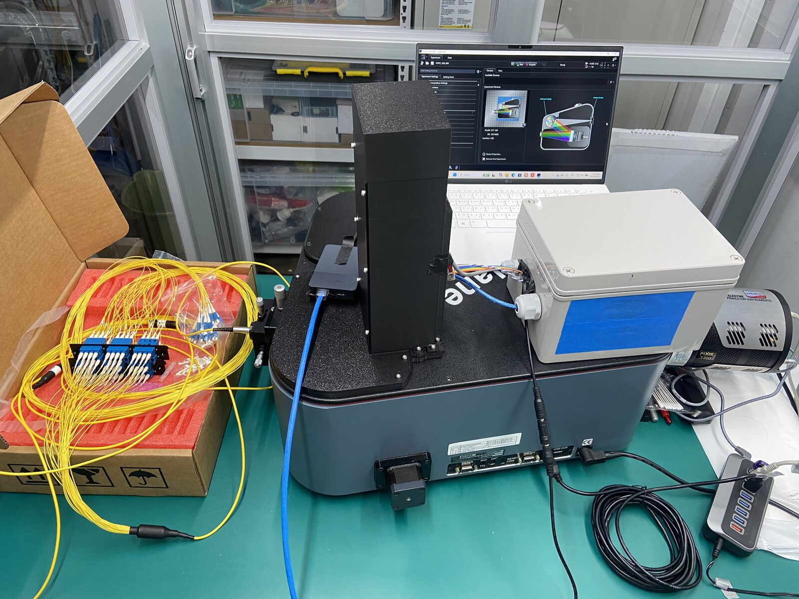
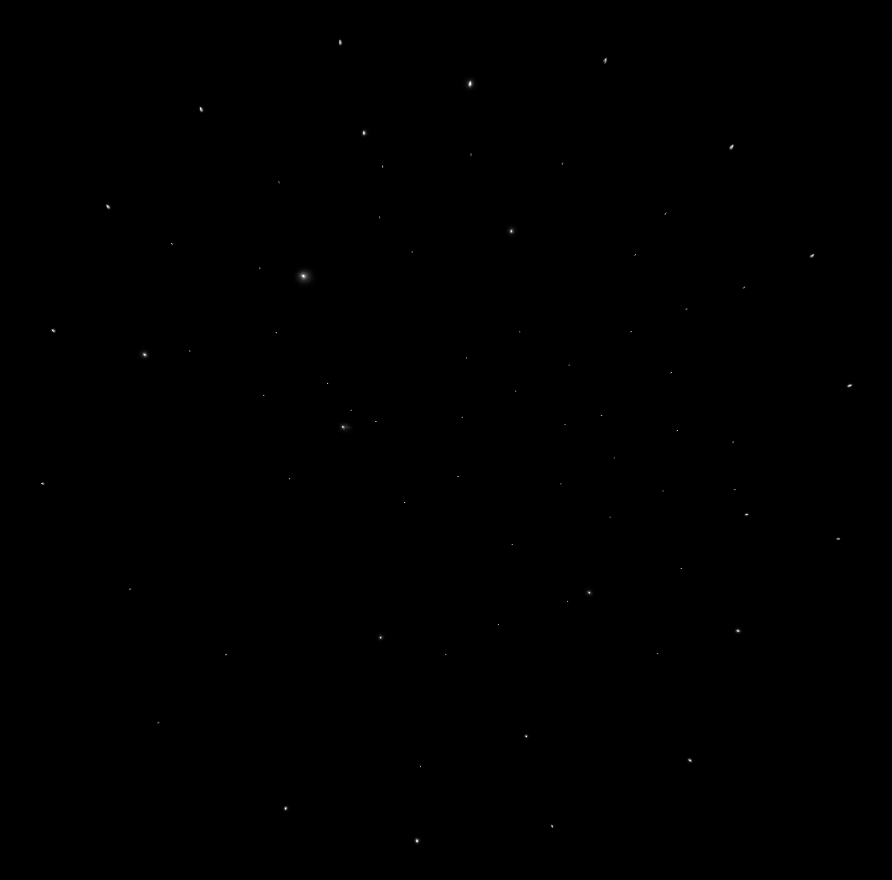
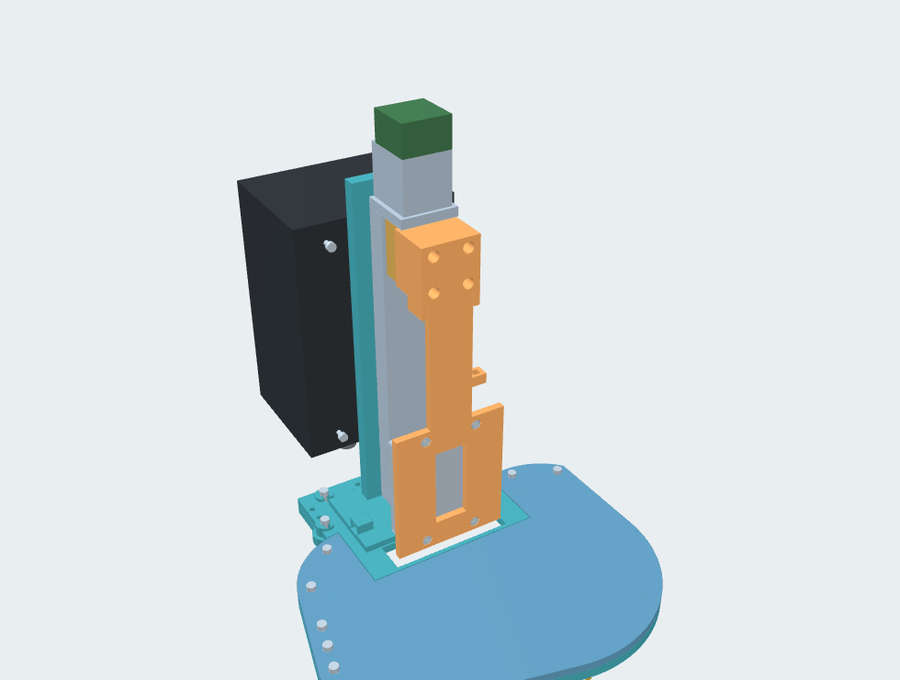
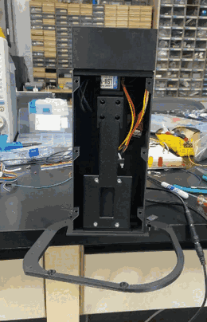
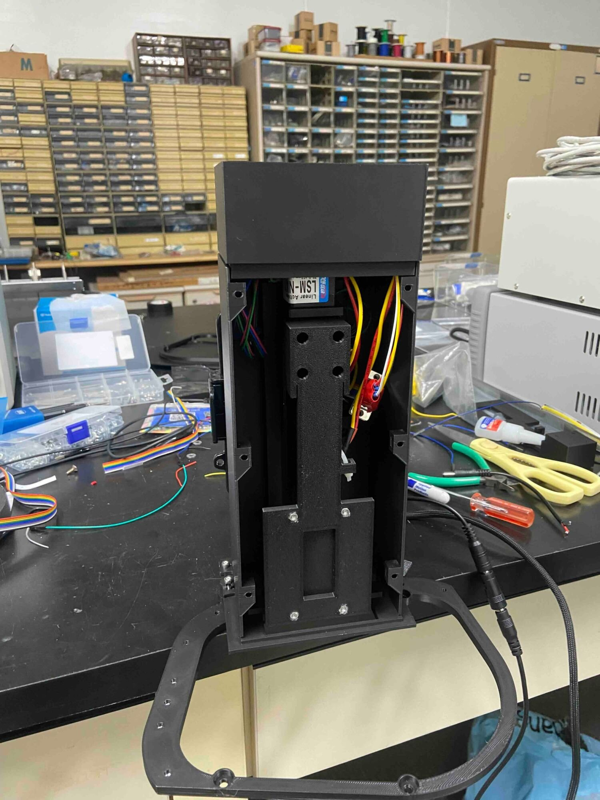
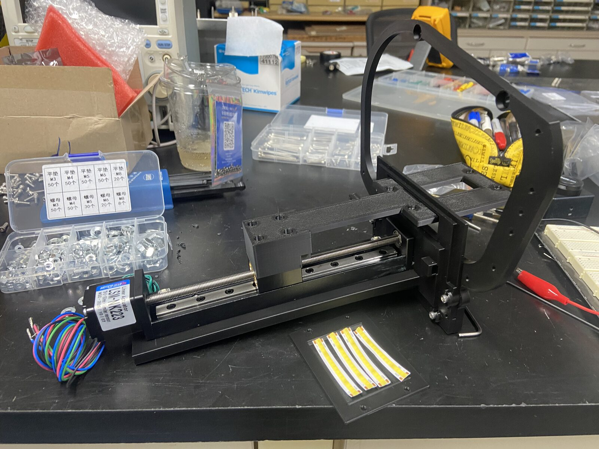
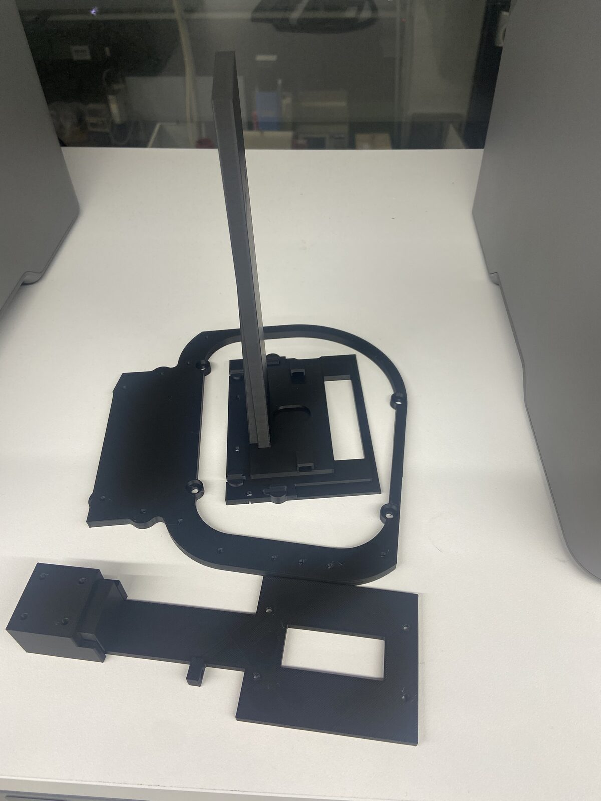

# IsoPlane back-illumination unit for K-SPEC

A retractable flat light that lowers into the grating-turret compartment of a Teledyne Princeton
Instruments **IsoPlane SCT320** spectrograph and shines back through its entrance slit, so the
fibres of the K-SPEC fibre positioner light up at the telescope focal plane.

**[Open the interactive 3D model](https://hbahk.github.io/isoplane-back-illumination/)**
· [Assembly STL](models/assembly_v17f_OUT.stl) · [Printed parts (STL)](models/print/)

**Status: built, installed and working as intended.** The unit (design v17f) has been in use on
the IsoPlane since October 2026: it inserts the light on command, back-illuminates the fibres,
and retracts fully out of the beam before science exposures.

<p align="center">
  
  
</p>
<p align="center"><sub>Left: the unit on the IsoPlane turret cover position, wiring box on the right. Right: fibre ends at the focal plane lit back through the spectrograph by the unit.</sub></p>

## Why this was needed

K-SPEC is a multi-object fibre spectrograph: robotic positioners place each fibre on a target,
and a metrology camera checks where every fibre end actually is. The camera can only see a fibre
if light comes out of it, so the fibres have to be **back-illuminated** from the spectrograph end.

For the current commissioning runs the fibres feed an IsoPlane SCT320 instead of the main K-SPEC
spectrograph. The IsoPlane has no way to inject light backwards through its slit, and the slit
end of the fibre bundle is not accessible while it is mounted. The only room near the slit, on
the optical axis, is the grating-turret compartment under the turret cover. A light placed there,
facing the slit, sends light back through the slit into the fibres.

The requirements followed from that:

- The light must sit on the optical axis (slit height) for metrology, and be **completely out of
  the turret volume** for science frames, so the gratings can rotate and no stray light remains.
- It must go in and out remotely and repeatably, many times a night.
- Mounting must not modify the spectrograph: no drilling, only the existing cover screws.
- It must be light-tight when parked, and safe if the control PC crashes (the lamp must not stay
  on into a science exposure).

## How it works

The original turret cover is replaced by a printed ring base held by the same four `#8-32` cover
screws. A vertical tower on the ring carries a 150 mm linear stage. The flat light hangs from the
stage carriage with its emitting face toward the slit.

- **OUT (parked):** the light is fully retracted into the tower above the lid. Light centre
  +54.6 mm above the spectrograph body top. The turret is free to rotate.
- **IN (illuminating):** the stage drives the light 142 mm down through the turret opening. Light
  centre at −87.4 mm, the slit height on the optical axis.

<p align="center">
  
  
</p>
<p align="center"><sub>Left: the 3D model with the enclosure hidden. Right: a bench cycle (2× speed). The light goes down, switches on, and returns to the parked position.</sub></p>

### Structure

All structural parts are 3D-printed on a Bambu Lab P2S. They were designed for PETG and printed in
PLA. The design is a CadQuery script pipeline: solids are built in code from measured dimensions,
then a rigid-body interference sweep runs over the whole stroke, followed by print preparation.
Every printed part prints **without supports**: overhangs are designed out with 45° gussets and
chamfers. All nuts are pushed into open pockets after printing (no print-pause inserts).

| Part | Role | Print size (mm) | ≈ g |
|---|---|---|---|
| `ring_base` | Replaces the turret cover; fixed with the 4 original #8-32 screws plus M4 washers, so the screw heads sit at the original height | 202 × 199 × 6 | 73 |
| `tower_base` | Base plate and stage support wall in one piece; slotted for −8…+4 mm adjustment toward or away from the turret | 124 × 92 × 214 | 119 |
| `lid` | Closes the rest of the opening, wraps the enclosure with a 0.5 mm gap, overlaps the tower base for light-tightness | 209 × 157 × 8 | 112 |
| `enclosure` | Light-tight tower shell; carries the wiring box on its back wall | 122 × 84 × 225 | 225 |
| `top_cap` | Separate cap over the motor and stepper driver (the tower is taller than the 256 mm print volume) | 105 × 77 × 56 | 80 |
| `front_panel` | Screw-on service panel for the light and carrier | 225 × 104 × 2 | 62 |
| `light_carrier` | Connects the stage table to the light, 15 mm total insert thickness | 189 × 68 × 27 | 54 |
| `backup_led_module`, `backup_reflector` | Backup light A: two 5 mm white LEDs aimed at a 32 × 32 mm diffuse reflector | 61 × 76 × 11 | 15 |
| `backup_strip_module` | Backup light B: four 50 mm 24 V COB strip segments on a 2 mm plate (built and tested) | 76 × 61 × 3 | 10 |
| `coupon_*` | Fit coupons for nut pockets and bosses; print these first | | |

The STLs in [`models/print/`](models/print/) are already in print orientation. GitHub shows each
one in a 3D preview. The backup lights fit the same four holes as the Metaphase light and swap in
without changing anything else.

Purchased parts: Metaphase MB-TBL2X2 2×2" 24 V flat light · LSM-NK223 150 mm linear stage (1600
steps/mm) with Near/Far limit switches · SBC-11R4 stepper driver (Modbus RTU over RS-485) · M3
screws and nuts · BOXCO BC-AGS-081807 wiring box with PG7 cable glands.

### Circuit

```
PC ── USB ── Arduino Uno ──┬── MAX485 ── RS-485 (A, B, G) ── SBC-11R4 ── stage motor
                           │                                   └── Near / Far limit switches
                           └── relay K1 ── J1 (3-pin) ── flat light, or backup light A / B
                               relay K2: spare

24 V adapter ─┬─ F1 1 A ─ 1N4004 ─ 100 µF ─ SBC-11R4 supply
              └─ F2 1 A ─ K1 ─ J1 (+24 V, DIM, GND), 100 µF at the relay output for the lamp inrush
```

- One 24 V adapter powers the stepper driver and the light. The Uno, the RS-485 transceiver and
  the relay coils run from USB 5 V.
- The firmware ([`electronics/firmware/kspec_bl_nano/`](electronics/firmware/kspec_bl_nano/)) is a
  small line protocol over USB serial. `L MAIN ON|OFF` switches the light. `MB <hex>` passes a
  Modbus frame to the driver and appends the CRC. `PING` keeps the watchdog alive.
- **Fail-safe:**
  - If the host stops talking for 60 s, the firmware turns the light off and sends a stop frame to
    the driver.
  - Unplugging USB drops the relay, so the light goes off.
  - The driver stops on its limit switches on its own, even if the Uno hangs.
- The supply paths (inrush, fuse sizing, reverse polarity, brown-out of the driver) were
  simulated in ngspice before building. The two 100 µF capacitors came out of that analysis.

## Operation

Host scripts are in [`electronics/host/`](electronics/host/): `bl_cycle.py` (Python and
pyserial) and `bl.ps1` (Windows PowerShell, no Python needed). One cycle:

1. Home to the Near switch, with the last millimetres at 1–2 mm/s.
2. Move down to IN at 10 mm/s (16000 steps/s).
3. Light on for the exposure time, keeping the watchdog alive.
4. Light off, then return to Near.
5. Approach the last 2 mm at 1 mm/s, as a lost-step check.
6. Release the motor current at rest.

```bash
python electronics/host/bl_cycle.py --dry-run          # print the command lines only
python electronics/host/bl_cycle.py -d 130 -t 10       # 130 mm down, light 10 s, back
```

Rules built into the scripts:
- Moves are bounded relative moves only, and a move is never resent automatically.
- The IN depth is a soft limit counted from the Near switch.
- The speed register is rewritten before every move, because the driver forgets it at power-up.
- Never rotate the turret while the light is IN.
- On a new installation, go in 10 mm steps the first time.

## Verification

- **Design:** a rigid-body interference check over the full stroke reports no collisions. Every
  printed part is a single closed body and support-free in its print orientation.
- **Bench (October 2026):** a full cycle (home, 130 mm IN at 10 mm/s, light on, OUT) ran through
  the Uno and the wiring box, with no lost steps. Steps per mm and the limit-switch trip points
  were measured. The watchdog was tested: the light went off and the stage stopped exactly 60 s
  after the last command. The backup strip plate was run through the same relay.
- **On the instrument:** after installation on the IsoPlane, the unit inserts and retracts
  reliably. It back-illuminates the fibres for metrology (image above), and stays out of the
  beam during science frames.

## What is not in this repository

The design was built against the vendor's exterior STEP model of the IsoPlane SCT320. That model
and every dimension taken from it are not public, so they are **not** included here:

- The 3D viewer and the assembly STL show only the unit. The spectrograph body, turret opening
  and turret are left out.
- Coordinates are shifted to an arbitrary origin in x and y. Only z = 0 keeps its meaning: the top
  face of the spectrograph body.
- The CAD source scripts, which read that model, are not published.

The printed parts are the as-built v17f geometry. If you want to build one, measure your own
spectrograph first, especially the turret depth.

## Repository layout

```
index.html                 interactive 3D viewer (GitHub Pages), self-contained
models/assembly_v17f_OUT.stl   whole unit, parked position, primary light
models/print/              printed parts, print-oriented STL
electronics/firmware/      Arduino firmware (Uno, USB serial line protocol)
electronics/host/          host scripts: bl_cycle.py, bl.ps1, sbc_frames.py (Modbus frame builder)
docs/img/                  photos and figures
archive/v10/, archive/v09/ earlier design reviews (actuator-based concept, superseded)
```

Earlier public versions (v09, v10) used a different actuator and are kept in
[`archive/`](archive/) for reference: [v10 viewer](https://hbahk.github.io/isoplane-back-illumination/archive/v10/),
[v09 viewer](https://hbahk.github.io/isoplane-back-illumination/archive/v09/).

<p align="center">
  
  
  
</p>
<p align="center"><sub>Build photos: the assembled tower with the front panel off; the stage and ring with the backup COB strip plate; printed parts before assembly.</sub></p>

Three.js r128 and OrbitControls are bundled in the viewer under the MIT licence; see
`THIRD_PARTY_NOTICES.txt`.
